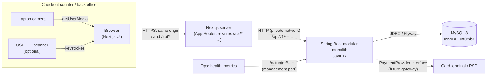
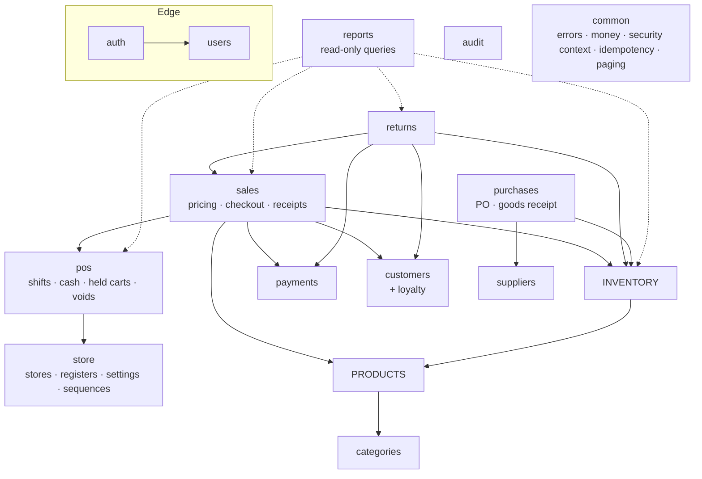
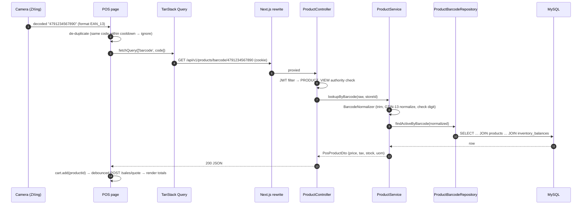

# 01 - System Architecture

Status: **Phase 1 - approved design baseline** (update via a dated "Decision log" entry at the bottom when something changes).

## 1. Scope and assumptions

| Topic | Assumption for v1 |
|---|---|
| Jurisdiction | Sri Lanka by default: currency **LKR**, timezone `Asia/Colombo`. Tax rates are **configuration**, not code. Seeded rates are examples; an accountant must confirm the real ones before going live. |
| Stores | The schema supports **multiple stores**. Every business record carries `store_id`. The v1 UI runs one store per session (the user picks it at login if they can access more than one). |
| Deployment | One backend instance plus one frontend instance plus MySQL. A horizontal-scale design note is in §11. |
| Payments | Cash is processed fully. Card payments are **recorded after an external terminal approves them** (the cashier enters the approval code and last 4 digits). No card data beyond the last 4 digits is ever stored. |
| Hardware | Camera scanning in the browser. USB/Bluetooth HID barcode scanners work automatically because they type into the focused search field. Cash drawers and receipt printers go through the browser print dialog only; there is no physical drawer control. |
| Offline | **Not supported in v1.** The POS needs connectivity to the backend. This is a deliberate trade-off: offline checkout needs local stock and pricing replication and later conflict resolution, which is a separate project. |

## 2. System context



**Key topology decision:** the browser talks only to the Next.js origin. Next.js rewrites `/api/*` to the backend. So:
- Auth cookies are **first-party, same-origin** (`SameSite=Strict`, `HttpOnly`, `Secure` in production).
- In the normal deployment the browser makes no CORS requests. CORS is still configured on the backend, with a narrow allow-list, for setups that call the API directly.
- The backend can stay on a private network.

## 3. Architecture style: modular monolith

One deployable Spring Boot application, split into **domain modules** with strict boundaries:



Every module may depend on `common`, `audit` and `store`.

**Boundary rules** (checked by an ArchUnit test in Phase 11):
1. A module never touches another module's **repository or entity graph for writes**. It calls the other module's **service** (for example `InventoryService.deductForSale(...)`).
2. Cross-module JPA relationships are limited to `@ManyToOne` references by id (for example `SaleItem → Product`). There are no cascading collections across modules.
3. `reports` is the only module allowed to run read-only, cross-module aggregate SQL. It never writes.
4. Controllers contain no business logic. They validate the DTO, call one service method, and map the result.
5. Entities never leave the service layer. Controllers receive and return DTOs only.

**Module responsibilities**

| Module | Owns tables | Responsibility |
|---|---|---|
| `common` | `idempotency_records`, `document_sequences` | Error model, `Money`/rounding utilities, current-user context, correlation IDs, pagination DTOs, idempotency service, sequence generator |
| `auth` | `refresh_tokens`, `approval_grants` | Login, refresh rotation, logout, JWT issuing and validation, manager-approval tokens, login rate limiting |
| `users` | `users`, `roles`, `permissions`, `user_roles`, `role_permissions`, `user_store_access` | User and role administration, password and PIN changes |
| `store` | `stores`, `registers`, `settings`, `tender_types` | Store profile, receipt header/footer, registers, typed settings (discount limits, loyalty rules), tender configuration |
| `categories` | `categories` | Category tree CRUD |
| `products` | `products`, `product_barcodes`, `tax_rates`, `product_promotions` | Catalog, barcode normalization and lookup, tax rates, product promotions |
| `inventory` | `inventory_balances`, `inventory_batches`, `stock_movements`, `stock_adjustments(+items)`, `stock_counts(+items)`, `stock_alerts` | Ledger, stock validation and locking, batches (FEFO), adjustments, write-offs, counts and reconciliation, valuation |
| `suppliers` | `suppliers` | Supplier CRUD |
| `purchases` | `purchase_orders(+items)`, `goods_receipts(+items)` | PO lifecycle, partial receiving, GRNs posted to the ledger |
| `pos` | `cashier_shifts`, `cash_movements`, `held_carts(+items)`, `transaction_voids` | Shift open/close, expected cash and variance, pay-in/pay-out, hold and resume, pre-payment voids |
| `sales` | `sales`, `sale_items`, `sale_discounts` | Pricing engine (quote), checkout orchestration, receipt rendering data, sale queries |
| `payments` | `payments` | Tender validation, change calculation, `PaymentProvider` boundary, refund tender recording |
| `customers` | `customers`, `loyalty_accounts`, `loyalty_transactions` | Customer records, loyalty ledger, earn and redeem rules |
| `returns` | `returns`, `return_items`, `refunds` | Returnable-quantity validation, refund calculation, restocking |
| `reports` | - | Aggregations, CSV export |
| `audit` | `audit_logs` | Append-only audit trail of sensitive actions |

## 4. Backend package layout

```
backend/
├── pom.xml
├── Dockerfile
└── src/
    ├── main/
    │   ├── java/com/supermarket/pos/
    │   │   ├── PosApplication.java
    │   │   ├── common/
    │   │   │   ├── config/        (Jackson, OpenAPI, async, clock, JPA auditing)
    │   │   │   ├── error/         (ApiException hierarchy, ErrorCode, GlobalExceptionHandler)
    │   │   │   ├── money/         (MoneyPolicy, Rounding, Quantity)
    │   │   │   ├── idempotency/
    │   │   │   ├── sequence/
    │   │   │   ├── security/      (CurrentUser, StoreAccessGuard)
    │   │   │   ├── web/           (CorrelationIdFilter, PageResponse, SortWhitelist)
    │   │   │   └── persistence/   (BaseEntity, AuditableEntity)
    │   │   ├── auth/
    │   │   │   ├── controller/ service/ repository/ entity/ dto/ mapper/
    │   │   │   ├── jwt/           (JwtService, CookieBearerTokenResolver)
    │   │   │   └── config/        (SecurityConfig, RateLimitFilter)
    │   │   ├── users/  store/  categories/  products/  inventory/
    │   │   ├── suppliers/  purchases/  pos/  sales/  payments/
    │   │   ├── customers/  returns/  reports/  audit/
    │   │   │   └── (each: controller/ service/ repository/ entity/ dto/ mapper/ [validation/] [event/])
    │   └── resources/
    │       ├── application.yml, application-dev.yml, application-prod.yml
    │       ├── db/migration/          (V1__..., V2__... Flyway; the schema source of truth)
    │       ├── db/seed-dev/           (R__ starter data, only loaded in the dev profile)
    │       └── logback-spring.xml
    └── test/java/com/supermarket/pos/
        ├── <module>/...               (unit tests: services with Mockito)
        ├── <module>/...IT.java        (Testcontainers MySQL integration tests)
        └── architecture/ModuleBoundaryTest.java
```

Interfaces are used **only where they add value**:
- `PaymentProvider` (cash, manual card, future gateway).
- `ReceiptNumberGenerator`/`SequenceGenerator` (testability).
- `Clock` injected everywhere time matters (deterministic tests).

Plain domain services are concrete `@Service` classes. They are mocked with Mockito where needed, without `FooService`/`FooServiceImpl` pairs.

Mapping is **hand-written mapper classes** (no MapStruct). They are explicit, easy to debug, and there are few enough DTOs that boilerplate stays manageable.

## 5. Frontend layout (Next.js App Router, JavaScript)

```
frontend/
├── package.json, next.config.mjs (rewrites /api → backend), postcss/tailwind config
├── Dockerfile
├── src/
│   ├── app/
│   │   ├── layout.js, globals.css, providers.js   (QueryClientProvider, Toaster)
│   │   ├── (auth)/login/page.js
│   │   ├── (admin)/layout.js                       (sidebar shell, permission-aware nav)
│   │   │   ├── dashboard/  products/  categories/  inventory/  suppliers/
│   │   │   ├── purchases/  sales/  customers/  returns/  reports/
│   │   │   └── users/  settings/  audit/  shifts/
│   │   └── (pos)/pos/page.js                       (full-screen cashier, no admin chrome)
│   ├── features/<module>/                          (api.js, hooks.js [TanStack Query], components/, schemas.js [Zod])
│   │   ├── auth/ pos/ scanner/ products/ inventory/ ...
│   ├── components/ui/                              (Button, Input, DataTable, Dialog, ConfirmDialog, Skeleton, EmptyState, Pagination)
│   ├── lib/
│   │   ├── http.js        (Axios instance: withCredentials, XSRF header, 401 → single-flight refresh → retry)
│   │   ├── money.js       (string-decimal ↔ integer minor units, formatting; never float math)
│   │   ├── permissions.js (UI-only hints; the server is the authority)
│   │   └── keyboard.js    (shortcut manager that ignores events from unrelated inputs)
│   ├── stores/            (Zustand: posCartStore, scannerStore, sessionStore)
│   └── middleware.js      (redirects to /login when no session cookie; UX only, not security)
└── tests/
    ├── unit/   (Vitest + React Testing Library)
    └── e2e/    (Playwright)
```

**State ownership**
- **Server state** (products, stock, sales, reports) lives in TanStack Query.
- **Cart in progress** lives in a Zustand store persisted to `sessionStorage`, so an accidental refresh does not lose a basket. It holds only product IDs, quantities and requested discounts. The prices it shows are **server-quoted**.
- **Session user** comes from `/auth/me` through TanStack Query. Tokens are never readable from JavaScript.

## 6. Request flow (example: barcode scan → add to cart)



## 7. Security architecture

| Concern | Design |
|---|---|
| Passwords | BCrypt (strength 12). Optional 4–6 digit **approval PIN** for managers, also BCrypt hashed and rate-limited. |
| Access token | JWT (HS256, 256-bit secret from `JWT_SECRET`), **10 min** TTL. Claims: `sub` (user id), `username`, `roles`, `perms`, `stores`, `sid` (token-family id). Validated by Spring Security's OAuth2 Resource Server `JwtDecoder`. A custom `BearerTokenResolver` reads it from the `POS_AT` cookie. |
| Refresh token | Opaque 256-bit random value in the `POS_RT` cookie (`HttpOnly; Secure; SameSite=Strict; Path=/api/v1/auth`). Only its SHA-256 hash is stored. **Rotation on every use**; the old token is marked `replaced_by`. **Reuse detection:** presenting an already-rotated token revokes the whole family (theft signal) and writes an audit log. TTL 12 h (one shift plus margin), absolute family lifetime 7 days. |
| Logout | Revokes the family and clears both cookies. Access tokens die within 10 min. Disabling a user also revokes all of that user's families. |
| CSRF | Cookie authentication means CSRF protection is **on**. Spring `CookieCsrfTokenRepository` (`XSRF-TOKEN` cookie readable by JS, `X-XSRF-TOKEN` header) is used, and Axios supports this pattern natively. Combined with `SameSite=Strict`, this gives defence in depth. |
| CORS | Allow-list from `APP_CORS_ALLOWED_ORIGINS`, credentials allowed, no wildcard. |
| Authorization | Permission strings become Spring authorities. `@PreAuthorize("hasAuthority('POS_SELL')")` on service entry points, **plus** in-service checks for data-dependent rules (store access, own-sales-only, discount ceilings). |
| Store isolation (IDOR) | Every query by id also filters by `store_id IN (user's stores)` through `StoreAccessGuard`. A record in another store returns **404, not 403**, so its existence does not leak. |
| Manager approval | `POST /approvals`: the manager enters username plus PIN/password on the cashier's screen. The server returns a **single-use approval token** (2 min TTL) scoped to `{action, store, requesting user, limit}`. The checkout or return request carries the token, and the server **consumes it inside the same transaction**. |
| Rate limiting | Bucket4j (in-memory) on `/auth/login`, `/auth/refresh` and `/approvals`, keyed by IP plus username. On top of that, DB-backed **account lockout** (5 failures → 15 min). The limits are per instance; §11 covers what changes when scaling out. |
| Error hygiene | RFC 9457 `ProblemDetail` with no stack traces. Logins return the same error for an unknown user and a wrong password. |
| Logging | JSON logs with `correlationId`, `userId` and `storeId`. Passwords, tokens, PINs, full phone numbers and emails are **never** logged (masking converter). |

### Roles → permissions matrix

`●` = granted by default (editable by SUPER_ADMIN; the seed is a starting point).

| Permission | SUPER_ADMIN | ADMIN | MANAGER | CASHIER | INVENTORY_STAFF |
|---|:-:|:-:|:-:|:-:|:-:|
| `SYSTEM_CONFIG` (settings, tender types, tax rates, stores) | ● | | | | |
| `ROLE_MANAGE` | ● | | | | |
| `USER_MANAGE` / `USER_VIEW` | ● | ● | / ● | | |
| `REGISTER_MANAGE` | ● | ● | | | |
| `CATEGORY_MANAGE`, `PRODUCT_MANAGE`, `PRICE_MANAGE` | ● | ● | | | |
| `PRODUCT_VIEW` | ● | ● | ● | ● | ● |
| `PRODUCT_VIEW_COST` | ● | ● | ● | | ● |
| `INVENTORY_VIEW` | ● | ● | ● | | ● |
| `INVENTORY_RECEIVE`, `INVENTORY_ADJUST`, `INVENTORY_COUNT` | ● | ● | ● | | ● |
| `INVENTORY_WRITE_OFF` | ● | ● | ● | | ● (needs approval above limit) |
| `INVENTORY_COUNT_POST` | ● | ● | ● | | |
| `SUPPLIER_MANAGE`, `PURCHASE_ORDER_MANAGE` | ● | ● | ● | | ● |
| `PURCHASE_ORDER_APPROVE` | ● | ● | ● | | |
| `POS_SELL`, `POS_HOLD_CART`, `SHIFT_OPERATE` | ● | ● | ● | ● | |
| `DISCOUNT_APPLY` (within the role's `max_discount_percent`) | ● | ● | ● | ● (e.g. 0 %) | |
| `DISCOUNT_APPROVE`, `PRICE_OVERRIDE`, `VOID_APPROVE` | ● | ● | ● | | |
| `CASH_MOVEMENT` / `CASH_MOVEMENT_APPROVE` | ● | ● | ● / ● | ● / | |
| `RETURN_CREATE` / `RETURN_APPROVE` | ● | ● | ● / ● | ● / | |
| `SALE_VIEW_OWN` / `SALE_VIEW_ALL` / `RECEIPT_REPRINT` | ● | ● | ● / ● / ● | ● / / ● | |
| `CUSTOMER_VIEW` / `CUSTOMER_MANAGE` / `LOYALTY_ADJUST` | ● | ● | ● / ● / ● | ● / ● / | |
| `SHIFT_VIEW_ALL`, `SHIFT_VARIANCE_APPROVE` | ● | ● | ● | | |
| `DASHBOARD_VIEW`, `REPORT_VIEW`, `REPORT_EXPORT` | ● | ● | ● | | (inventory reports only) |
| `REPORT_FINANCIAL` (cost, estimated profit) | ● | ● | | | |
| `AUDIT_VIEW` | ● | ● | | | |

## 8. Money, quantities, tax and rounding policy

These rules are implemented once, in `common.money` and `sales.pricing`. The frontend only **estimates** with the same rules in integer minor units.

| Rule | Decision |
|---|---|
| Java type | `BigDecimal` only. Never `double`. `MoneyPolicy` constants: `SCALE = 2`, `RoundingMode.HALF_UP`. |
| DB types | Money `DECIMAL(15,2)`. Unit cost and average cost `DECIMAL(15,4)`. Quantity `DECIMAL(15,3)`. Tax rate `DECIMAL(6,3)` percent. |
| JSON | Money and quantities are serialized as **strings** (`"1250.00"`, `"0.750"`) so JavaScript never parses them into floats. |
| Units | `EACH`, `PACK`, `BOTTLE` → integer quantities only (scale 0, validated). `KG`, `G`, `L`, `ML` → up to 3 decimals. Minimum quantity > 0. |
| Tax mode | `stores.prices_include_tax` (default **true**, the usual shelf-price practice). Inclusive: `tax = round(net × r / (100 + r))`. Exclusive: `tax = round(net × r / 100)` added on top. |
| Tax rates | `tax_rates` table (for example `VAT_STD`, `VAT_EXEMPT`), with effective dates. Each product references one rate. The sale line **snapshots** the rate percent. |
| Line math | `gross = round(unitPrice × qty)` → minus `promoDiscount` → minus `manualDiscount` → minus `allocatedTxnDiscount` = `net` → `tax` from net. Each step is rounded to 2 dp. |
| Transaction discount | Allocated to lines in proportion to line net, using the **largest-remainder method** so the allocations add up exactly to the discount. Tax stays correct per rate. |
| Totals | Sum of the rounded line values. Header values are never recomputed from aggregates, so lines always add up to the header. |
| Cash rounding | Off by default. When enabled, `rounding_adjustment` is recorded separately and only for cash tender. |
| Profit | `estimated_gross_margin = net_excl_tax − cost_amount`, where cost is the **moving average cost snapshot** at sale time. It is labelled "Estimated gross margin", never "profit". |

## 9. Concurrency and consistency strategy

| Risk | Control |
|---|---|
| Overselling | During checkout: `SELECT … FROM inventory_balances WHERE store_id=? AND product_id IN (…) ORDER BY product_id FOR UPDATE`. The deterministic order avoids deadlocks. Stock is validated and decremented in the same transaction. The DB also enforces `CHECK (quantity_on_hand >= 0)` as a backstop. |
| Batch allocation | Batch rows are locked `FOR UPDATE` in FEFO order (expiry ascending, then received ascending) after the balance row is locked. |
| Duplicate checkout | The `Idempotency-Key` header (UUID generated when the payment dialog opens) is inserted into `idempotency_records` **inside the checkout transaction**, under a unique key (`user_id`, `operation`, `key`). A concurrent duplicate blocks on InnoDB's unique-index lock. When the first transaction commits, the duplicate gets a duplicate-key error and the stored sale is **replayed** with 200. If the first rolls back, the duplicate proceeds normally. A different request body under the same key returns `422 IDEMPOTENCY_KEY_REUSED`. |
| Double stock deduction | Movements are written only by `InventoryService` within the checkout transaction. `stock_movements` has a unique key (`reference_type`, `reference_id`, `product_id`, `batch_id`, `movement_type`) for document-generated rows. |
| Duplicate or excess returns | The original `sales` row is locked `FOR UPDATE`, then `sale_items.quantity_returned + requested ≤ quantity` is checked. A DB `CHECK` enforces the same rule. Returns also take an idempotency key. |
| Concurrent admin edits | `@Version` optimistic locking on products, categories, suppliers, POs, stores, users and loyalty accounts. A conflict returns `409 CONCURRENT_MODIFICATION`. |
| Receipt number gaps or collisions | `document_sequences` row per (type, scope, period), incremented with `SELECT … FOR UPDATE` in the business transaction. Per-register scope means registers never contend with each other. |
| One open shift per register/cashier | Generated columns `open_register_key` and `open_cashier_key` (value when `status='OPEN'`, otherwise `NULL`), each with a UNIQUE index. MySQL allows multiple NULLs, so only one OPEN row can exist. |
| Price changed between quote and pay | Checkout carries `expectedGrandTotal`. If the server total differs, it returns `409 QUOTE_MISMATCH` with the fresh quote, and nothing is charged or committed. |
| Long transactions | No external calls inside DB transactions. Card approval happens **before** checkout on the external terminal. A future gateway flow uses an intent/confirm pattern (see [02-business-workflows.md §W4b](02-business-workflows.md)). |

## 10. Events, async, scheduling

- `SaleCompletedEvent`, `ReturnCompletedEvent`, `GoodsReceivedEvent` and `StockAdjustedEvent` are published inside the transaction and handled with `@TransactionalEventListener(phase = AFTER_COMMIT)` plus `@Async`. They are used **only for non-critical side effects**: low-stock alert generation, metrics counters and cache eviction.
- **Audit logs are written synchronously in the same transaction.** An audited action must not commit without its audit row, so audit does not use async events.
- Scheduled jobs (`@Scheduled`, single instance): daily expiring-batch alerts, hourly low-stock sweep, purge of expired idempotency records (> 7 days) and refresh tokens, and expiry of held carts older than the store setting.
- No message broker. If external delivery becomes a requirement (accounting, e-commerce), add a **transactional outbox** table polled by a relay. This is a noted design, not a v1 feature.

## 11. Observability and operations

- Actuator on a **separate management port** (`8081`). It exposes `health` (with `liveness` and `readiness` groups), `info`, `metrics` and `prometheus`, and nothing else is exposed.
- Custom metrics: `pos.checkout.duration`, `pos.checkout.failures{code}`, `pos.sales.amount`, `pos.idempotency.replays`, `pos.auth.login.failures`.
- `CorrelationIdFilter`: accepts or creates `X-Correlation-Id`, puts it in MDC and echoes it in the response and in error bodies.
- Logback JSON encoder (Logstash format) in the `prod` profile and readable console logs in `dev`.
- Scaling out later needs: a shared rate-limit store (Bucket4j JDBC/Redis), ShedLock for scheduled jobs, and nothing else. Sessions are stateless JWT and refresh tokens are in the DB.

## 12. Technology baseline

Exact patch versions are verified against Maven Central and npm at the start of the phase that introduces them. The rule: latest stable, no release candidates.

| Layer | Choice | Notes |
|---|---|---|
| JDK | **Java 17 LTS** (`java.version=17`) | Already installed. Language level 17: records, text blocks, sealed types, `instanceof` patterns. No switch pattern matching and no virtual threads. |
| Framework | **Spring Boot 3.5.16** (Spring Framework 6.2, Security 6.5, Hibernate 6.6, Jackson 2) | Latest 3.x line, still receiving patch releases (checked 2026-10-18). |
| DB migration | Flyway (Boot-managed) + `flyway-mysql` | |
| API docs | springdoc-openapi 2.8.x (the Boot 3.5-compatible line) | `/swagger-ui.html`, disabled in prod unless enabled by env |
| Rate limit | Bucket4j core | in-memory |
| Tests | JUnit 5, Mockito, Spring Security Test, ArchUnit | Integration tests (`*IT`) run against a local `pos_test` database |
| Frontend | **Next.js 16** (App Router, JS), React 19, Tailwind CSS 4 | |
| Data/state | Axios, TanStack Query 5, Zustand 5 | |
| Forms | React Hook Form 7, Zod 4, @hookform/resolvers | |
| UI | lucide-react, Radix primitives (Dialog/AlertDialog for accessible confirmations), sonner (toasts) | |
| Charts | Recharts | |
| Scanner | @zxing/browser + @zxing/library | |
| FE tests | Vitest, React Testing Library, Playwright | |
| DB | MySQL 8.x (target) / MariaDB 10.4+ (local dev via XAMPP) | portable SQL subset |

## 13. Decision log

| # | Date | Decision | Why |
|---|---|---|---|
| D1 | 2026-10-18 | Modular monolith, 16 modules, ArchUnit-checked | Simple operations, strong boundaries, splittable later |
| D2 | 2026-10-18 | Next.js proxies `/api` (same-origin cookies) | First-party HttpOnly cookies, `SameSite=Strict`, no CORS in the default path |
| D3 | 2026-10-18 | JWT access token (10 min) + rotating opaque refresh token with reuse detection | Short exposure window, server-side revocation |
| D4 | 2026-10-18 | Single-use, scoped manager-approval tokens | Approval is bound to one action and consumed atomically, so it cannot be replayed |
| D5 | 2026-10-18 | Pessimistic row locks on `inventory_balances` at checkout, ordered by product_id | Hard guarantee against overselling, deadlock-safe |
| D6 | 2026-10-18 | Idempotency record inserted in the business transaction | Exactly-once sale with no "in-progress" limbo state |
| D7 | 2026-10-18 | Money as strings in JSON; frontend uses integer minor units | No float drift anywhere |
| D8 | 2026-10-18 | Tax-inclusive pricing default, per-product tax rate, snapshotted on sale | Matches local shelf pricing; rate changes don't rewrite history |
| D9 | 2026-10-18 | Stock lives in a per-store ledger, not on `products` | Multi-store, auditable, reconcilable |
| D10 | 2026-10-18 | Barcodes normalized to GTIN-13 where applicable, multiple barcodes per product | UPC-A and EAN-13 scans of the same item match; pack variants |
| D11 | 2026-10-18 | No offline mode in v1 | Out of scope; needs a replication design |
| D12 | 2026-10-18 | Hand-written mappers, no MapStruct | Explicit, few DTOs, no annotation-processing surprises |
| D13 | 2026-10-18 | Price-embedded (variable-weight, prefix 20–29) barcodes deferred | Needs store-specific label configuration; parser boundary reserved |
| D14 | 2026-10-18 | Inter-store stock transfers deferred to the backlog | Movement types are reserved; v1 is single-store operation |
| D15 | 2026-10-18 | **Java 17 + Spring Boot 3.5.x** instead of Java 21 + Boot 4 (owner decision) | Matches the installed JDK; mature ecosystem. Upgrading to 21/Boot 4 later is a contained change (Jackson 3, Security 7, Hibernate 7 migration). |
| D16 | 2026-10-18 | **No Docker.** Local MariaDB/MySQL; integration tests against a local `pos_test` schema (owner decision) | Matches the developer machine (XAMPP MariaDB 10.4). Migrations stay portable to MySQL 8. |
