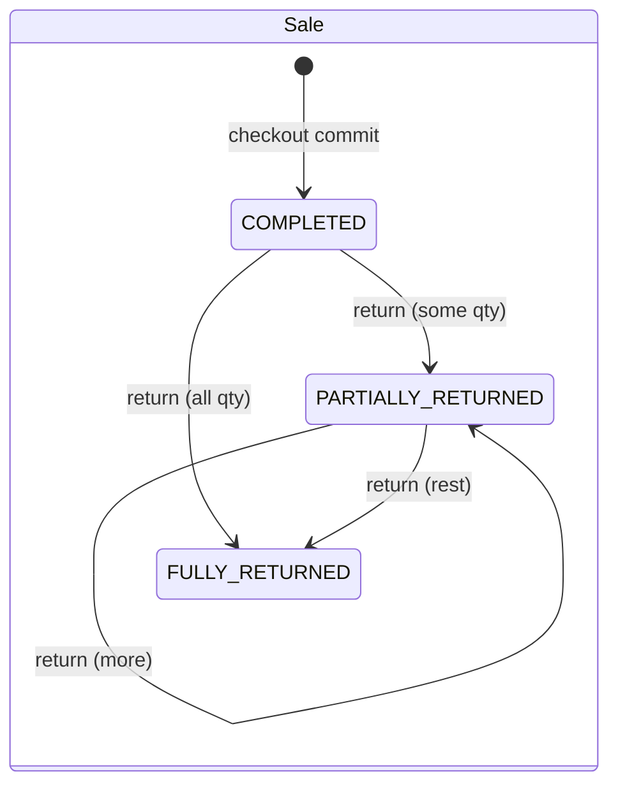
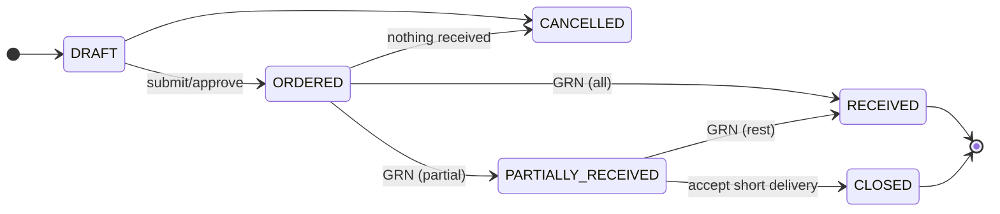
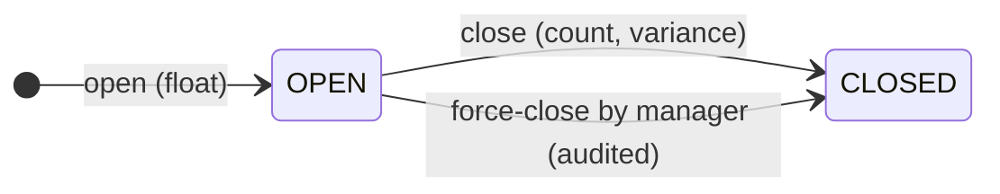
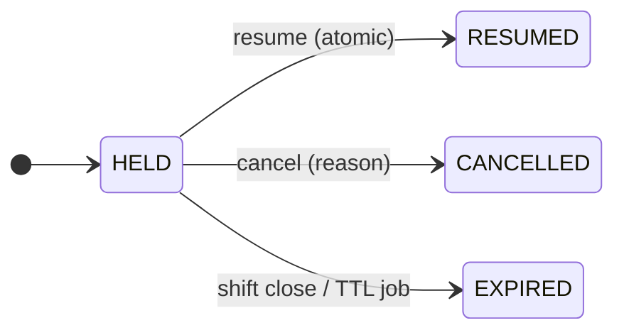
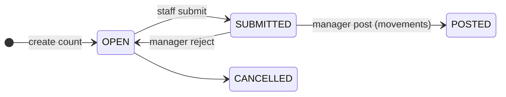

# 02 — Core Business Workflows

Each workflow lists actors, steps, the server-side rules and failure behaviour. State machines are at the end.

---

## W1. Login, refresh, logout

```mermaid
sequenceDiagram
  autonumber
  actor U as User
  participant FE as Next.js UI
  participant API as AuthController/AuthService
  participant DB as MySQL
  U->>FE: username + password
  FE->>API: POST /api/v1/auth/login (X-XSRF-TOKEN)
  API->>API: rate-limit (IP+username)
  API->>DB: load user, roles, permissions, stores
  API->>API: status ACTIVE? not locked? BCrypt match?
  alt bad credentials
    API->>DB: failed_login_count++ (lock at 5 → 15 min)
    API-->>FE: 401 INVALID_CREDENTIALS (generic)
  else ok
    API->>DB: reset counter, insert refresh_tokens(hash, family)
    API-->>FE: 200 {user} + Set-Cookie POS_AT, POS_RT
  end
  Note over FE,API: ...10 min later an API call returns 401 TOKEN_EXPIRED
  FE->>API: POST /api/v1/auth/refresh (POS_RT cookie)   [single-flight: concurrent 401s wait on one refresh]
  API->>DB: find by SHA-256(token) FOR UPDATE
  alt token already rotated (reuse)
    API->>DB: revoke whole family, audit SECURITY_TOKEN_REUSE
    API-->>FE: 401 → redirect /login
  else valid
    API->>DB: mark old replaced, insert new (same family)
    API-->>FE: 200 + new cookies; FE retries original request
  end
  U->>FE: Logout
  FE->>API: POST /api/v1/auth/logout → revoke family, clear cookies
```

## W2. Cashier shift lifecycle

1. The cashier logs in and opens `/pos`. The UI calls `GET /pos/shifts/current`.
2. If there is no open shift, the UI shows the **Open shift** dialog: pick a register (active registers in the cashier's store) and enter the opening float. `POST /pos/shifts`.
   - The server rejects the request if the register or the cashier already has an OPEN shift (unique generated-column index → `409 SHIFT_ALREADY_OPEN`).
3. Selling happens (W3/W4). Each sale references `shift_id`.
4. Pay-in / pay-out / cash drop: `POST /pos/shifts/{id}/cash-movements` with type, amount and reason. A pay-out above the configured limit needs an approval token (`CASH_MOVEMENT_APPROVE`).
5. Close: the cashier counts cash (an optional denomination breakdown is stored in the JSON details) → `POST /pos/shifts/{id}/close {countedCash}`.
   - Server: `expected = opening_float + cash sales (tendered − change) − cash refunds + pay-ins − pay-outs − drops`.
   - `variance = counted − expected`. If `|variance|` is above the `shift.varianceApprovalThreshold` setting, a `SHIFT_VARIANCE_APPROVE` approval token is required.
   - Held carts still open on the shift are **expired** (and audited).
6. Shift report (X-report while open, Z-report on close): `GET /pos/shifts/{id}/summary`.

**Assignment model:** one cashier ↔ one register ↔ one OPEN shift at a time. A cashier who moves registers must close and reopen. A manager can force-close an abandoned shift (`SHIFT_VIEW_ALL` + `SHIFT_VARIANCE_APPROVE`), which is audited.

## W3. Scan / search → cart → quote

```mermaid
sequenceDiagram
  autonumber
  actor C as Cashier
  participant SC as Scanner dialog
  participant Cart as Zustand cart
  participant API as Backend
  C->>SC: F2 / "Scan" → camera permission prompt (first time)
  SC->>SC: enumerate devices, start preferred camera, ZXing decode loop
  SC-->>Cart: code (de-dup: ignore same code < 1.5 s; a new code is accepted immediately)
  Cart->>API: GET /products/barcode/{code}
  alt 404 BARCODE_NOT_FOUND
    API-->>C: toast "Unknown barcode" (+ "Register product" if PRODUCT_MANAGE)
  else found & active
    Cart->>Cart: add line or qty+1 (weighed items: open the quantity dialog)
    Cart->>API: POST /sales/quote (debounced 200 ms, latest-wins)
    API-->>Cart: authoritative lines, totals, stock warnings, required approvals
  end
```

- Manual entry: the search field accepts a barcode (all digits, length 8/12/13/14 → barcode lookup) or text (→ `GET /products?q=` typeahead by name or SKU). Enter submits. **USB HID scanners type into this field and end with Enter, so they work with no extra code.**
- The quote is **advisory**. It never reserves stock. Checkout re-runs exactly the same pricing code.

## W4. Checkout (cash / externally approved card)

**Request:** `POST /api/v1/sales/checkout` with `Idempotency-Key: <uuid>` (generated once when the payment dialog opens and reused for retries of that attempt).

Server steps, all in **one** `@Transactional` method (`CheckoutService.checkout`):

| # | Step | Failure → response (whole transaction rolls back) |
|---|---|---|
| 1 | Insert `idempotency_records(user, 'CHECKOUT', key, request_hash)` | Duplicate key: same hash → **replay** stored sale (200); different hash → `422 IDEMPOTENCY_KEY_REUSED` |
| 2 | Verify `POS_SELL`, user ↔ store access, OPEN shift owned by the user on the given register | `403` / `409 SHIFT_NOT_OPEN` |
| 3 | Load products (active), the effective tax rate and active promotions | `422 PRODUCT_INACTIVE` |
| 4 | Validate quantities (> 0, unit scale) | `400 VALIDATION_FAILED` |
| 5 | Validate discounts and overrides: within the cashier's role limit, or a valid approval token is present → **consume the token** | `403 APPROVAL_REQUIRED` (with the required action) |
| 6 | Price everything (`PricingEngine`), compare with `expectedGrandTotal` | `409 QUOTE_MISMATCH` + fresh quote |
| 7 | Lock `inventory_balances` rows `FOR UPDATE` (ordered), check availability; for batch items lock batches FEFO | `409 INSUFFICIENT_STOCK` (lists products and available quantities) |
| 8 | Validate tenders: sum(non-cash) ≤ total; cash tendered ≥ remainder; change only from cash; loyalty redemption ≤ balance | `422 INSUFFICIENT_TENDER` / `PAYMENT_INVALID` |
| 9 | Next receipt number (`document_sequences` FOR UPDATE) | — |
| 10 | Insert `sales`, `sale_items`, `sale_discounts`, `payments` | DB constraint → `409`/`500` |
| 11 | Deduct balances and batches, insert `stock_movements(SALE)` with before/after | `CHECK` violation → `409 INSUFFICIENT_STOCK` |
| 12 | Loyalty: insert EARN (and REDEEM) transactions, update the account (`@Version`) | `409 CONCURRENT_MODIFICATION` → client retries with the same key |
| 13 | Audit (`SALE_COMPLETED`; discounts and overrides with approver) | — |
| 14 | Update the idempotency record with `resource_id = sale.id` | — |
| 15 | Publish `SaleCompletedEvent` (AFTER_COMMIT, async: low-stock alerts, metrics) | does not affect the sale |
| 16 | Return `SaleDto` with receipt data | — |

**Client behaviour:**
- The Pay button is disabled while the request is in flight.
- On network error or timeout the client **retries with the same key** (replay-safe).
- On 409 QUOTE_MISMATCH the new totals are shown and the cashier confirms again. The client uses a new key, because the body changes.
- After success the receipt preview opens, the print dialog is available (W8), and the cart is cleared.

### W4b. Future integrated card gateway (design only; not built in v1)

Never hold a DB transaction while a customer taps a card:
1. `POST /sales/payment-intents` (short transaction): price the cart, create `payment_intent(PENDING, amount, expires_at)`, **soft-reserve** stock (a reservation row with TTL).
2. The terminal or PSP processes the card outside any transaction. A webhook or poll confirms → `payment_intent(AUTHORIZED, provider_ref)`.
3. `POST /sales/checkout {paymentIntentId}`: same transaction as W4, consumes the reservation, and captures if needed.
4. An expired or failed intent releases its reservation (scheduled job). A capture failure after commit triggers compensation (void/refund at the PSP plus a reversal record).

v1 implements `PaymentProvider` with `CashPaymentProvider` and `ManualCardPaymentProvider` (records the external approval). A gateway provider plugs in behind the same interface.

## W5. Manager approval

1. The pricing response says `requiredApprovals: [{action: "DISCOUNT_OVER_LIMIT", requestedPercent: "15.00", cashierLimit: "5.00"}]`.
2. The cashier clicks **Request approval**. The manager types username plus PIN on the same screen → `POST /approvals {action, username, secret, context}`.
3. Server: rate-limit, verify the manager's credentials, the permission for that action, store access, and that the manager's own limit covers the value. It returns `{approvalToken, expiresAt (2 min), approverName}`. The manager's session is **not** logged in on that browser.
4. The token goes into the quote or checkout request. On checkout it is consumed (`consumed_at`, `consumed_ref`). A consumed or expired token returns `403 APPROVAL_INVALID`.
5. Approvals and denials are audited (`APPROVAL_GRANTED` / `APPROVAL_DENIED`).

Actions that require approval: `DISCOUNT_OVER_LIMIT`, `PRICE_OVERRIDE`, `LINE_VOID` (after the "void-free" threshold), `CART_VOID`, `RETURN`, `RETURN_WITHOUT_RECEIPT` (disabled by default), `CASH_PAYOUT_OVER_LIMIT`, `SHIFT_VARIANCE`, `WRITE_OFF_OVER_LIMIT`.

## W6. Hold / resume / void (pre-payment)

- **Hold:** `POST /pos/held-carts {label?, customerId?, items[{productId, qty}]}`. Discounts and approvals are **not** carried over, because they must be re-applied on resume. The UI clears the cart.
- **Resume:** `GET /pos/held-carts?status=HELD` (any register in the same store), then `POST /pos/held-carts/{id}/resume` (status HELD → RESUMED atomically, so it cannot be resumed twice) → the items load and are re-quoted at **current** prices.
- **Line void / cart cancel** (items scanned but no sale yet): `POST /pos/voids {type: LINE|CART, reasonCode, reasonText, items snapshot, approvalToken?}`. This writes `transaction_voids` for loss-prevention reporting. **There is no sale row, because there was no sale.**
- A void before payment is never a refund. After a sale is COMPLETED, the only path is W7.

## W7. Return and refund

```mermaid
sequenceDiagram
  autonumber
  actor C as Cashier
  actor M as Manager
  participant API as ReturnService
  participant DB as MySQL
  C->>API: GET /sales/receipt/{receiptNumber}
  API-->>C: sale + items with returnableQuantity
  C->>C: choose items, qty, condition (SALEABLE/DAMAGED/EXPIRED), reason
  M->>API: POST /approvals {action: RETURN}  (if the cashier lacks RETURN_APPROVE)
  C->>API: POST /returns (Idempotency-Key, approvalToken)
  API->>DB: idempotency insert; lock sales row FOR UPDATE
  API->>API: qty ≤ sold − already returned; within return window (setting, e.g. 14 days)
  API->>API: refund per line = net_amount × qty/sold (rounded; the last unit takes the remainder)
  API->>API: refund tenders ≤ original tender amounts (cash-only by default if paid in cash)
  API->>DB: insert returns, return_items, refunds; sale_items.quantity_returned += qty
  API->>DB: SALEABLE & restock → stock_movements(SALE_RETURN) (+ batch); others → stock_movements(WRITE_OFF_DAMAGED) or no-stock record per setting
  API->>DB: loyalty EARN_REVERSAL pro-rata; sale.status → PARTIALLY_RETURNED / FULLY_RETURNED
  API->>DB: audit RETURN_COMPLETED
  API-->>C: return receipt
```

- A cash refund requires the processor to have an OPEN shift; it reduces that shift's expected cash.
- A card refund is **recorded** with an external reference. The cashier performs it on the card terminal.
- Refunds can never exceed the amount paid on the original sale minus what has already been refunded. A DB `CHECK` enforces it at line level and the service enforces it at header level.

## W8. Receipt printing and reprint

- The receipt is rendered by a dedicated React print component using CSS `@media print` and `@page` sizes (`80mm` thermal width or `A4`, chosen in store settings or the print dialog).
- `GET /sales/receipt/{receiptNumber}` (or `/sales/{id}/receipt`) returns immutable stored data, not a recalculation.
- A reprint calls `POST /sales/{id}/reprints` → audit `RECEIPT_REPRINTED` (needs `RECEIPT_REPRINT`). The receipt is marked **"REPRINT / COPY"**. No sale or stock change.

## W9. Purchasing and goods receipt

1. `DRAFT` PO: supplier, store, lines (product, ordered quantity, expected unit cost).
2. Submit → `ORDERED` (needs `PURCHASE_ORDER_APPROVE` if the total is above the setting threshold).
3. Delivery arrives → `POST /purchases/orders/{id}/receipts` (GRN): received quantities per line (≤ outstanding), actual unit cost, batch number and expiry for tracked items, supplier invoice number. Idempotency-Key required.
4. In one transaction: insert the GRN and items; `po_item.quantity_received += qty`; create or increase `inventory_batches`; lock and increase `inventory_balances`; recompute **moving average cost** = `(onHand × avg + qty × cost) / (onHand + qty)`; insert `stock_movements(PURCHASE_RECEIPT)`; PO status → `PARTIALLY_RECEIVED` or `RECEIVED`.
5. `CLOSED` (short-shipped remainder accepted) or `CANCELLED` (only if nothing has been received).
6. Ad-hoc receipt without a PO is allowed with `INVENTORY_RECEIVE` (same transaction, `purchase_order_id = NULL`).

## W10. Stock adjustments, write-offs, counts

- **Adjustment / write-off:** `POST /inventory/adjustments {type: ADJUSTMENT|WRITE_OFF_DAMAGED|WRITE_OFF_EXPIRED, reason, items[{productId, batchId?, quantityChange}]}`. A write-off above the value threshold needs approval. The service locks balances, rejects results below zero, and writes movements. **There is no endpoint that sets stock to a value directly.**
- **Stock count (reconciliation):** create a count for a category or the whole store → the server snapshots `system_qty` → staff enter `counted_qty` → submit → a manager posts it → for each line a `COUNT_CORRECTION` movement of `counted − current_system_qty_at_post`. (Sales during the count are handled because the variance is applied against the live quantity at post time, and the snapshot difference is reported.)

## W11. Loyalty

- Settings: `loyalty.earnRate` (points per LKR 100 of net sale after discounts, excluding the loyalty-paid portion), `loyalty.pointValue` (LKR per point on redemption), `loyalty.minRedeem`.
- Earn happens in the checkout transaction (W4 step 12). Redeem is a tender type `LOYALTY` that reduces the balance in the same transaction.
- A return reverses earned points pro-rata. If the balance would go negative, the balance is floored at 0 and the shortfall is recorded.
- The ledger is append-only. `points_balance` is a cached sum protected by `@Version`.

---

## State machines



There is no PENDING sale in v1: a sale row exists only after full payment, which makes it immutable. W4b adds a `PaymentIntent` state machine instead of mutating sales.








