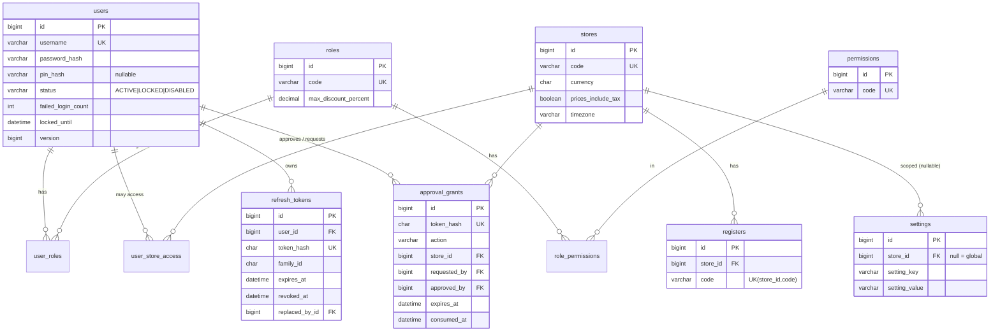
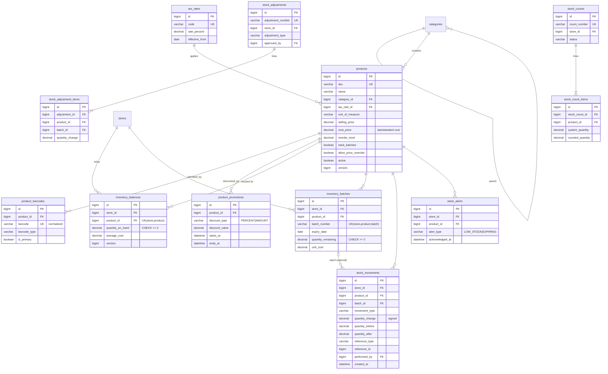
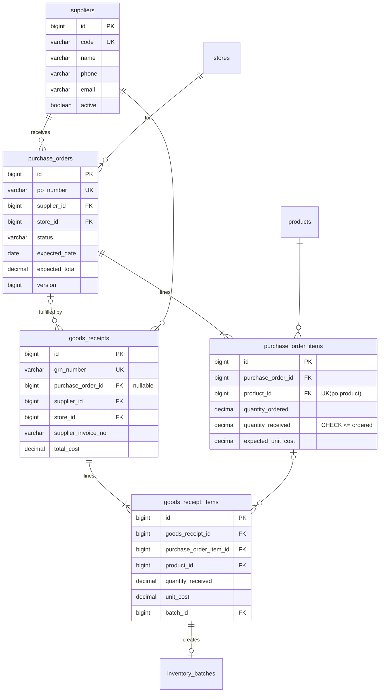
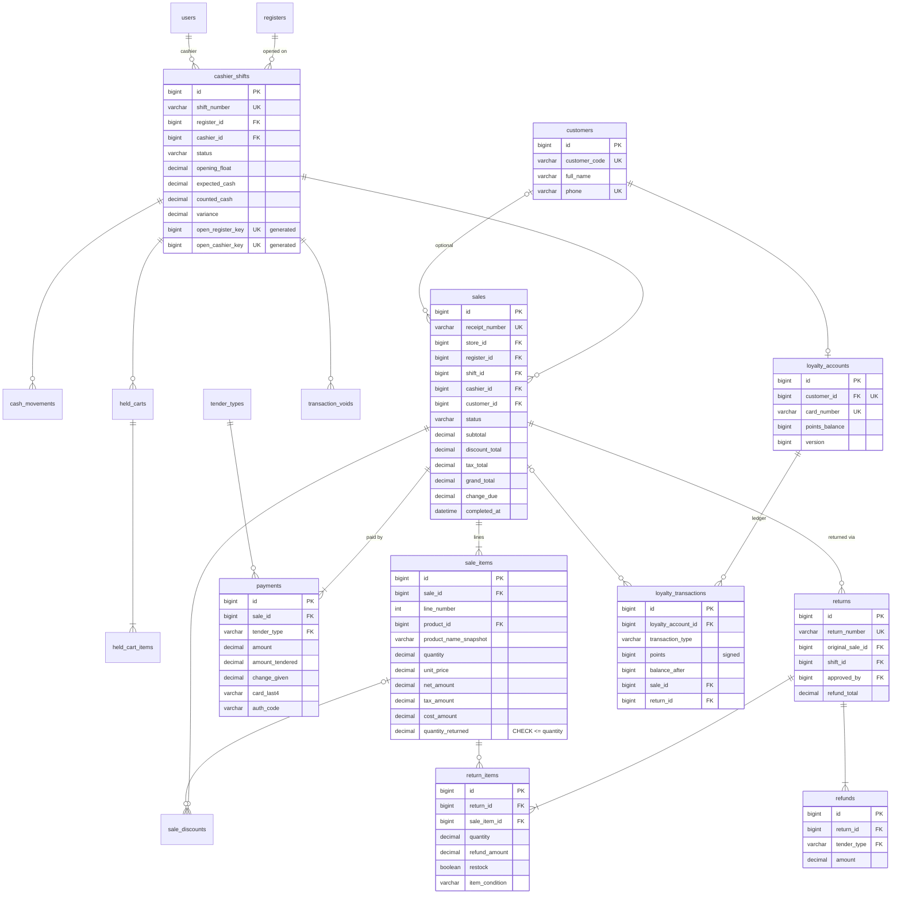
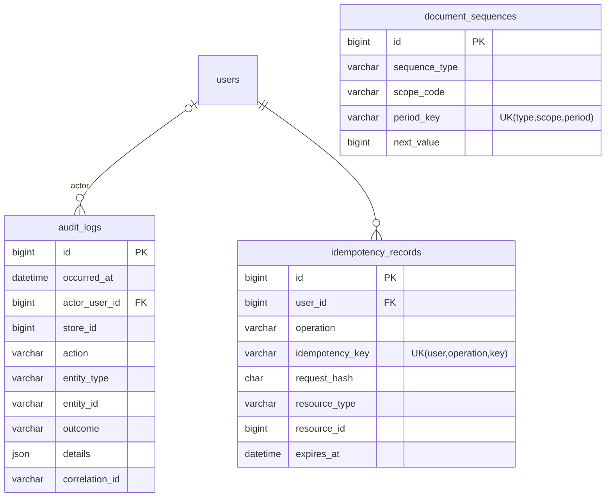

# 03 - Database Design (MySQL 8 / MariaDB 10.4+, InnoDB)

The Flyway migrations in `backend/src/main/resources/db/migration` are the **source of truth**. This document is the design they implement. If the two disagree, the migration wins and this document gets fixed.

## 1. Conventions

| Item | Rule |
|---|---|
| Engine / charset | InnoDB, `utf8mb4`, `utf8mb4_unicode_ci` (available on both MySQL 8 and MariaDB; case-insensitive unique keys for codes and usernames) |
| PK | `id BIGINT AUTO_INCREMENT`. Join tables use composite PKs. |
| FKs | Always declared, `ON DELETE RESTRICT` (business rows are never hard-deleted; they are deactivated). The only `CASCADE` is child lines of drafts (held cart items). |
| Timestamps | `DATETIME(6)` in **UTC**. JDBC `connectionTimeZone=UTC`, `preserveInstants=true`. The UI converts to the store timezone. |
| Money | `DECIMAL(15,2)`. Costs `DECIMAL(15,4)`. Quantities `DECIMAL(15,3)`. Rates `DECIMAL(6,3)`. |
| JSON-ish data | `LONGTEXT` holding JSON written by the app (portable; MariaDB's JSON type is LONGTEXT anyway) |
| Enums | `VARCHAR(30)` + `CHECK (col IN (...))` (enforced by MySQL ≥ 8.0.16 and MariaDB ≥ 10.2). Mapped with `@Enumerated(STRING)`. |
| Optimistic lock | `version BIGINT NOT NULL DEFAULT 0` on mutable aggregates |
| Audit columns | `created_at`, `updated_at`, plus `created_by`/`updated_by` (user id) where useful |
| Immutable tables | `stock_movements`, `loyalty_transactions`, `audit_logs`, `payments`, `refunds`, `sales`/`sale_items` (except `status` and `quantity_returned`). In production the app DB user gets **no DELETE** on these (documented in the deployment guide). |
| Naming | snake_case plural tables; `uk_<table>_<cols>`, `fk_<table>_<ref>`, `ix_<table>_<cols>`, `ck_<table>_<rule>` |

## 2. ER diagrams (by domain)

Only keys and the most important columns are drawn. §3 has every column.

### 2.1 Identity, access, store

### 2.2 Catalog and inventory

### 2.3 Purchasing

### 2.4 POS, sales, payments, returns, customers

### 2.5 Cross-cutting

## 3. Table catalogue

`NN` = NOT NULL. All tables have `id` PK unless noted.

### Identity & store
| Table | Columns | Constraints / indexes |
|---|---|---|
| `users` | username NN, full_name NN, email, password_hash NN, pin_hash, status NN, failed_login_count NN 0, locked_until, last_login_at, password_changed_at, must_change_password NN, created_at, updated_at, version | `uk_users_username`, `uk_users_email`, `ck_users_status` |
| `roles` | code NN, name NN, description, max_discount_percent `DECIMAL(5,2)` NN 0, system_role NN | `uk_roles_code`, `ck_roles_discount (0..100)` |
| `permissions` | code NN, description, module NN | `uk_permissions_code` |
| `user_roles` | user_id, role_id | PK(user_id, role_id), FKs |
| `role_permissions` | role_id, permission_id | PK(role_id, permission_id), FKs |
| `user_store_access` | user_id, store_id, is_default NN | PK(user_id, store_id) |
| `refresh_tokens` | user_id NN, token_hash `CHAR(64)` NN, family_id `CHAR(36)` NN, issued_at, expires_at, family_expires_at, revoked_at, revoke_reason, replaced_by_id, user_agent, ip_address | `uk_rt_hash`, `ix_rt_family`, `ix_rt_user` |
| `approval_grants` | token_hash NN, action NN, store_id NN, requested_by NN, approved_by NN, register_id, limit_value `DECIMAL(15,2)`, context_json, issued_at, expires_at, consumed_at, consumed_ref_type, consumed_ref_id | `uk_ag_hash`, `ix_ag_expires` |
| `stores` | code NN, name NN, address_line1, address_line2, city, phone, email, tax_registration_no, currency `CHAR(3)` NN, timezone NN, prices_include_tax NN, receipt_header, receipt_footer, active, timestamps, version | `uk_stores_code` |
| `registers` | store_id NN, code NN, name NN, active NN, timestamps | `uk_registers_store_code` |
| `settings` | store_id (NULL=global), setting_key NN, setting_value NN, value_type NN, updated_by, updated_at | `uk_settings_scope_key (scope_store_key, setting_key)` where `scope_store_key = COALESCE(store_id,0)` as a generated column |
| `tender_types` | code PK `VARCHAR(20)`, name NN, is_cash NN, requires_reference NN, allows_change NN, active NN, sort_order | seeded: CASH, CARD, LOYALTY |
| `document_sequences` | sequence_type NN, scope_code NN, period_key NN, next_value NN | `uk_docseq` |

### Catalog & inventory
| Table | Columns | Constraints / indexes |
|---|---|---|
| `categories` | parent_id, code NN, name NN, description, sort_order, active, timestamps, version | `uk_categories_code`, `ix_categories_parent` |
| `tax_rates` | code NN, name NN, rate_percent NN, effective_from NN, effective_to, active | `uk_tax_rates_code`, `ck_rate (0..100)` |
| `products` | sku NN, name NN, description, category_id NN, brand, unit_of_measure NN, cost_price `(15,4)` NN, selling_price NN, tax_rate_id NN, reorder_level NN 0, track_batches NN, track_expiry NN, allow_price_override NN, image_url, active NN, created_by, timestamps, version | `uk_products_sku`, `ix_products_name` (+ FULLTEXT on name, brand), `ix_products_category_active`, `ck_products_uom`, `ck_products_prices (>= 0)` |
| `product_barcodes` | product_id NN, barcode `VARCHAR(32)` NN, barcode_type NN, is_primary NN, created_at | `uk_pb_barcode`, `ix_pb_product` |
| `product_promotions` | product_id NN, name, discount_type NN, discount_value NN, starts_at NN, ends_at NN, active, created_by | `ix_promo_product_window (product_id, starts_at, ends_at)`, `ck_promo_window` |
| `inventory_balances` | store_id NN, product_id NN, quantity_on_hand NN 0, average_cost `(15,4)` NN 0, last_movement_at, version | `uk_ib_store_product`, `ck_ib_nonneg` |
| `inventory_batches` | store_id, product_id, batch_number NN, expiry_date, received_at NN, unit_cost NN, quantity_received NN, quantity_remaining NN, goods_receipt_item_id, status NN (ACTIVE/DEPLETED/EXPIRED) | `uk_batch`, `ix_batch_fefo (store_id, product_id, status, expiry_date, received_at)`, `ck_batch_nonneg` |
| `stock_movements` | store_id, product_id, batch_id, movement_type NN, quantity_change NN, quantity_before NN, quantity_after NN, unit_cost, reference_type NN, reference_id, reference_line_id, reason, performed_by NN, created_at NN | `ix_sm_store_product_time`, `ix_sm_reference`, `ix_sm_type_time`, `uk_sm_doc_line (reference_type, reference_id, reference_line_id, batch_key, movement_type)` where `batch_key = COALESCE(batch_id,0)` as a generated column (prevents double posting), `ck_sm_type`, `ck_sm_after (after = before + change)` |
| `stock_adjustments` | adjustment_number NN, store_id, adjustment_type NN, reason NN, status NN, total_value, created_by, approved_by, created_at | `uk_adj_number` |
| `stock_adjustment_items` | adjustment_id, product_id, batch_id, quantity_change NN, unit_cost, reason | `ck_adj_item_nonzero` |
| `stock_counts` | count_number, store_id, category_id, status, created_by, submitted_by, posted_by, created_at, posted_at, version | `uk_count_number` |
| `stock_count_items` | stock_count_id, product_id, system_quantity NN, counted_quantity, quantity_at_post, variance | `uk_count_item (count, product)` |
| `stock_alerts` | store_id, product_id, batch_id, alert_type, message, created_at, acknowledged_by, acknowledged_at | `ix_alerts_open (store_id, acknowledged_at)` |

`movement_type` ∈ `OPENING_BALANCE, PURCHASE_RECEIPT, SALE, SALE_RETURN, ADJUSTMENT_IN, ADJUSTMENT_OUT, WRITE_OFF_DAMAGED, WRITE_OFF_EXPIRED, COUNT_CORRECTION, TRANSFER_OUT, TRANSFER_IN` (the last two are reserved).
`unit_of_measure` ∈ `EACH, PACK, BOTTLE, KG, G, L, ML`.

### Purchasing
| Table | Columns | Constraints |
|---|---|---|
| `suppliers` | code, name NN, contact_person, phone, email, address, tax_registration_no, payment_terms_days, notes, active, timestamps, version | `uk_suppliers_code`, `ix_suppliers_name` |
| `purchase_orders` | po_number, store_id, supplier_id, status, order_date, expected_date, expected_total, notes, created_by, approved_by, approved_at, timestamps, version | `uk_po_number`, `ix_po_supplier_status`, `ck_po_status` |
| `purchase_order_items` | purchase_order_id, product_id, quantity_ordered NN, quantity_received NN 0, expected_unit_cost NN | `uk_poi (po, product)`, `ck_poi_qty (ordered > 0 AND received BETWEEN 0 AND ordered)` |
| `goods_receipts` | grn_number, store_id, supplier_id, purchase_order_id, supplier_invoice_no, received_at, received_by, total_cost, notes | `uk_grn_number`, `ix_grn_po` |
| `goods_receipt_items` | goods_receipt_id, purchase_order_item_id, product_id, quantity_received NN, unit_cost NN, batch_number, expiry_date, batch_id | `ck_gri_qty (> 0)` |

### POS, sales, payments, returns
| Table | Columns | Constraints |
|---|---|---|
| `cashier_shifts` | shift_number, store_id, register_id, cashier_id, status, opened_at, opening_float, closed_at, closed_by, expected_cash, counted_cash, variance, variance_approved_by, close_notes, denomination_json, version, **open_register_key** `GENERATED (IF(status='OPEN', register_id, NULL)) STORED`, **open_cashier_key** (same for cashier_id) | `uk_shift_number`, `uk_shift_open_register`, `uk_shift_open_cashier`, `ix_shift_store_opened` |
| `cash_movements` | shift_id, movement_type (PAY_IN/PAY_OUT/CASH_DROP), amount, reason NN, performed_by, approved_by, created_at | `ck_cm_amount (> 0)` |
| `held_carts` | store_id, register_id, shift_id, held_by, customer_id, label, status, held_at, resumed_at, resumed_by, version | `ix_held_store_status` |
| `held_cart_items` | held_cart_id (CASCADE), product_id, quantity, line_number | |
| `transaction_voids` | store_id, register_id, shift_id, cashier_id, approved_by, void_type, reason_code, reason_text, items_json, estimated_amount, created_at | `ix_voids_store_time` |
| `sales` | receipt_number, store_id, register_id, shift_id, cashier_id, customer_id, status, currency, prices_include_tax, subtotal, line_discount_total, transaction_discount_total, discount_total, tax_total, grand_total, rounding_adjustment, amount_paid, change_due, item_count, cost_total, loyalty_points_earned, loyalty_points_redeemed, completed_at, created_at, version | `uk_sales_receipt`, `ix_sales_store_completed`, `ix_sales_cashier_completed`, `ix_sales_shift`, `ix_sales_customer`, `ck_sales_totals (grand_total >= 0 ...)` |
| `sale_items` | sale_id, line_number, product_id, sku_snapshot, barcode_snapshot, product_name_snapshot, unit_of_measure, quantity, unit_price, original_unit_price, price_override_by, gross_amount, promo_discount_amount, manual_discount_amount, allocated_txn_discount_amount, net_amount, tax_rate_id, tax_rate_percent, tax_amount, unit_cost, cost_amount, quantity_returned NN 0, refunded_amount NN 0 | `uk_si_sale_line`, `ix_si_product`, `ck_si_qty (> 0)`, `ck_si_returned (BETWEEN 0 AND quantity)`, `ck_si_refunded (<= net_amount)` |
| `sale_discounts` | sale_id, sale_item_id, source (PROMOTION/MANUAL_LINE/MANUAL_TRANSACTION/PRICE_OVERRIDE), method, value, amount, reason, promotion_id, applied_by, approved_by | `ix_sd_sale` |
| `payments` | sale_id, tender_type, amount, amount_tendered, change_given, status, provider, provider_reference, card_brand, card_last4 `CHAR(4)`, auth_code, recorded_by, created_at | `ix_pay_sale`, `ix_pay_tender_time`, `ck_pay_amount (> 0)` |
| `returns` | return_number, store_id, register_id, shift_id, original_sale_id, processed_by, approved_by, reason_code, notes, refund_total, tax_total, created_at | `uk_returns_number`, `ix_returns_sale` |
| `return_items` | return_id, sale_item_id, product_id, quantity, refund_amount, tax_amount, restock, item_condition, reason | `ck_ri_qty (> 0)` |
| `refunds` | return_id, tender_type, amount, reference, card_last4, processed_by, created_at | `ck_refund_amount (> 0)` |

### Customers & cross-cutting
| Table | Columns | Constraints |
|---|---|---|
| `customers` | customer_code, full_name NN, phone (E.164-normalized), email, marketing_consent, active, timestamps, version | `uk_cust_code`, `uk_cust_phone`, `ix_cust_name` |
| `loyalty_accounts` | customer_id, card_number, points_balance NN 0, status, joined_at, version | `uk_la_customer`, `uk_la_card`, `ck_la_nonneg` |
| `loyalty_transactions` | loyalty_account_id, transaction_type, points, balance_after, sale_id, return_id, reason, created_by, created_at | `ix_lt_account_time` |
| `audit_logs` | occurred_at, actor_user_id, actor_username, store_id, action, entity_type, entity_id, outcome, summary, details LONGTEXT (JSON), ip_address, user_agent, correlation_id | `ix_audit_time`, `ix_audit_entity`, `ix_audit_actor_time`, `ix_audit_action_time` |
| `idempotency_records` | user_id, operation, idempotency_key, request_hash, resource_type, resource_id, response_status, created_at, expires_at | `uk_idem (user_id, operation, idempotency_key)`, `ix_idem_expires` |

## 4. Migration plan

| Version | Content | Phase |
|---|---|---|
| `V1__identity_and_store.sql` | users, roles, permissions, joins, user_store_access, stores, registers, settings, tender_types, document_sequences, idempotency_records, audit_logs | 2 |
| `V2__seed_reference_data.sql` | roles, permissions, role_permissions, tender types, **no users** | 2 |
| `V3__auth_tokens.sql` | refresh_tokens, approval_grants | 3 |
| `V4__catalog.sql` | categories, tax_rates, products, product_barcodes, product_promotions | 4 |
| `V5__inventory.sql` | balances, batches, movements, adjustments, counts, alerts | 5 |
| `V6__pos_shifts.sql` | cashier_shifts, cash_movements, held_carts(+items), transaction_voids | 6 |
| `V7__sales_payments.sql` | sales, sale_items, sale_discounts, payments | 7 |
| `V8__customers_loyalty.sql` | customers, loyalty_accounts, loyalty_transactions | 7 |
| `V9__returns.sql` | returns, return_items, refunds | 8 |
| `V10__purchasing.sql` | suppliers, purchase_orders(+items), goods_receipts(+items) | 9 |
| `db/seed-dev/R__*.sql` | Starter store, users, categories, products, barcodes, suppliers, opening stock | 2→9, only loaded when `spring.flyway.locations` includes `seed-dev` (dev profile) |

Rules: never edit an applied migration; add a new one. `spring.jpa.hibernate.ddl-auto=validate` makes startup fail if entities and schema drift apart.

## 5. Backup and restore

The full procedure goes in `docs/operations.md` in Phase 12. The summary:
- Nightly `mysqldump --single-transaction --routines --triggers --set-gtid-purged=OFF`, plus binary logs for point-in-time recovery.
- Test a restore to a scratch instance monthly.
- Encrypt backups at rest.
